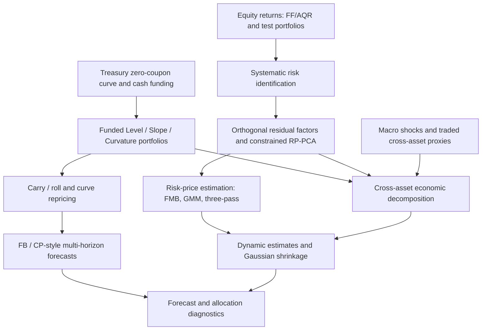
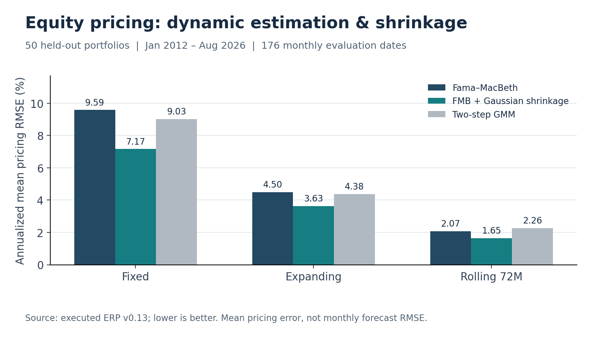
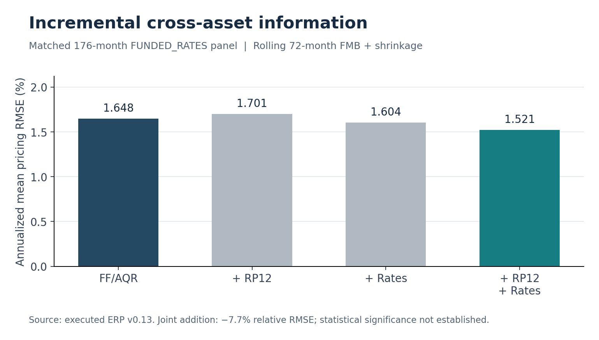
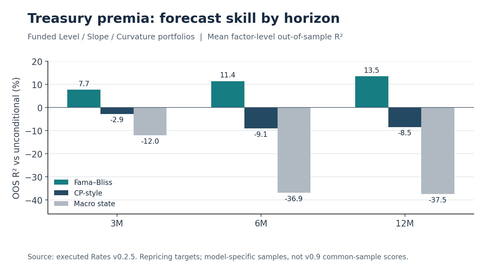
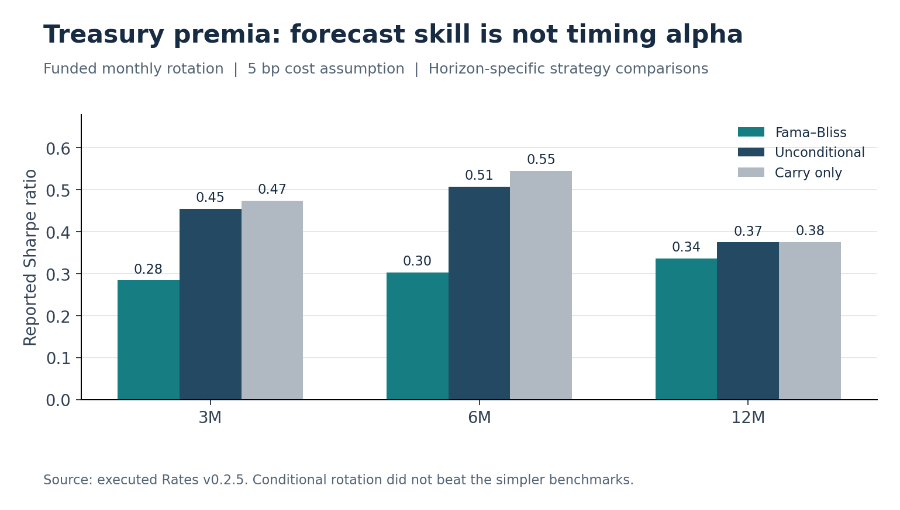

# Empirical Risk Premia Engine

**Cross-asset empirical asset pricing · Equity & Treasury rates · Systematic risk identification and expected-return estimation**

A modular Python research framework for estimating risk exposures and premia, discovering incremental priced risks beyond established equity factor models, and connecting conditional premia to funded factor portfolios. It combines empirical asset pricing, dynamic expected-return estimation and economic decomposition across Equity, Rates and traded cross-asset proxies. The research separates **risk attribution, mean pricing accuracy, conditional forecast skill and realized allocation performance** rather than treating them as interchangeable.

Release **v0.13.0** — consolidated public repository, November 2026. [Executed evidence](results/README.md) · [Methodology](docs/equity-dynamic-pricing.md) · [Rates research](docs/rates-research.md) · [Validation](docs/validation.md)

## Selected empirical findings

| Research experiment | Benchmark | Challenger | Result |
|---|---:|---:|---:|
| Equity pricing, rolling Fama–MacBeth | 2.069% | 1.648% (Gaussian shrinkage) | **20.3% lower mean pricing RMSE** |
| Equity pricing, joint residual and funded Rates factors | 1.648% | 1.521% | **7.7% further reduction** |
| Funded Rates, Fama–Bliss repricing forecasts | Unconditional forecast | 3M / 6M / 12M | **OOS R²: 7.66% / 11.38% / 13.48%** |

Equity: 50 held-out characteristic-sorted test portfolios, 176 monthly evaluation dates (Jan 2012–Aug 2026), same sample and estimator within each comparison. Rates: executed v0.2.5, mean factor-level repricing R² on model-specific forecast dates. Results are retrospective; reductions are numerical, not claims of statistically significant forecasting or trading alpha. Full provenance and metric definitions are below.

## 1. Research architecture



| Layer | Research components |
|---|---|
| Equity benchmarks | CAPM, FF3, Carhart4, FF5, FF6, BAB, QMJ; factor spanning, rolling beta attribution, static and FMB pricing |
| Incremental factor discovery | Residual covariance / circular-shift null; rolling PCA; pricing-oriented PCA; constrained risk-premium PCA with dollar and formation-beta neutrality |
| Pricing and inference | Fama–MacBeth with HAC, linear SDF / regularized two-step GMM, Giglio–Xiu-style three-pass latent factor estimation, synchronized block bootstrap |
| Dynamic premia | Fixed, expanding and trailing 72-month pricing; quarterly refits; Gaussian shrinkage of risk prices; direct traded-factor mean / posterior challengers |
| Treasury rates | Fitted zero-coupon curve, funded PCA factor-mimicking portfolios, carry/roll and exact curve repricing, FB / CP-style prediction at 3/6/12 months |
| Economic decomposition | Jarociński–Karadi policy and information shocks, FRED macro proxies, managed factors, funded Rates and ETF-based Credit/FX/Commodities/Volatility exposures |
| Validation / application | Held-out portfolios and dates, common calendars within panels, pricing error and forecast diagnostics, Rates rotation versus unconditional/carry benchmarks with transaction-cost sensitivity |

## 2. Equity: identification and pricing

### Standard factor models and residual risks

The benchmark uses 130 US equity portfolios (25 Size–Book-to-Market, 30 Industries, 25 Size–Momentum, 25 Size–Profitability and 25 Size–Investment). The standard model comparison covers July 1963–August 2026; rolling OOS attribution begins in July 1968. FF6+QMJ explains **82.58%** of realized OOS return variation using contemporaneous factor returns and previously estimated betas. FF6 alone has lower annualized alpha RMSE (1.657% vs 1.709%). This is factor attribution, not prediction.

Residual discovery uses the first three portfolio families (80 portfolios), with the other two families (50 portfolios) reserved for evaluation. These portfolio groups can share constituents. Five static residual PCs explain 41.25% of training residual variance, but none produces significant incremental alpha. Rolling pricing-oriented factors use trailing 120 months and annual formation. `RP12_PC2` achieves annualized gross OOS alpha of 1.668% (HAC t = 2.436, nominal p = 0.01485) over Jan 2006–Aug 2026; the result does **not** survive Holm correction across six rolling candidates (adjusted p ≈ 0.0891), much less broader research multiplicity. New factors are not certified premia.

The constrained RP-PCA adaptation extracts eigenvectors from the balanced-panel moment objective

$$ M_\gamma = R^\top R/T + \gamma\bar R\bar R^\top, \qquad \mathbf{1}^\top w=0,\quad B_{FF}^\top w=0. $$

Neutrality is imposed in the feasible subspace before extraction; the realized portfolio can acquire exposures after formation. Pricing-oriented methods and three-pass inference are research adaptations of Lettau–Pelger and Giglio–Xiu, not full replications of their published asymptotic inference.

### Dynamic risk prices and shrinkage

Estimate factor betas and mean risk prices from formation-only data; compare fixed, expanding and rolling 72-calendar-month windows with quarterly refits. For the FMB risk-price vector, a zero-centered Gaussian prior with covariance $D$ and HAC sampling covariance $V$ gives

$$ \widehat\lambda_{post}=D(D+V)^{-1}\widehat\lambda. $$



| Estimator (FF/AQR) | Fixed | Expanding | Rolling 72M |
|---|---:|---:|---:|
| Fama–MacBeth | 9.585% | 4.502% | 2.069% |
| FMB + shrinkage | 7.167% | 3.632% | **1.648%** |
| Two-step GMM | 9.026% | 4.378% | 2.260% |
| Historical asset mean | 9.659% | 4.491% | 1.879% |

**Metric.** Let $e_{it}=r_{it}-\hat\mu_{i,t-1}$ be monthly OOS forecast errors. The annualized cross-sectional RMSE of mean errors is

$$ 12\sqrt{\frac{1}{N}\sum_{i=1}^N\left(\frac{1}{T}\sum_{t=1}^T e_{it}\right)^2}. $$

This differs from the RMSE of individual monthly forecasts. Rolling FMB versus shrinkage monthly forecast RMSE is 5.679% versus 5.659%, respectively. The material improvement is in average pricing, not proven monthly timing skill. The executed notebook shows point scores; exported bootstrap and direct factor-score files were not supplied and significance is not established here.

### Cross-asset integration



On the same 176-date funded-Rates panel with rolling FMB shrinkage, adding RP12 alone gives 1.701% RMSE, funded Rates alone 1.604%, and both together 1.521% (FF/AQR benchmark 1.648%). The 7.7% improvement is **joint**, not attributable solely to Rates. The shorter ETF panel has weaker evidence: a simple historical asset mean can outperform richer models. Each panel uses its own common calendar; compare only within panels.

The economic layer estimates exposures of traditional and residual factors to macro and cross-asset risks. Contemporaneous mapping is distinct from lagged predictive regressions and prices of risk. ETF proxies are adjusted-price returns: HYG–IEF (not duration-neutral credit), UUP less cash, DBC less cash and VIXY less cash (volatility-futures exposure, not a pure variance risk premium). The funded Rates adapter is shared with the dedicated Rates research. Driver decomposition based on OLS and historical means is an accounting attribution, not an independent forecast of the total premium or causal allocation of risk prices.

[Equity methodology](docs/equity-dynamic-pricing.md) · [All dynamic pricing scores](results/tables/equity_dynamic_all.csv) · [Executed v0.13 notebook](results/evidence/equity_v013_executed.ipynb)

## 3. Treasury rates: funded factors and bond premia

The rates adapter uses the Federal Reserve's fitted Kim–Wright zero-coupon curve (1–10Y) and FEDFUNDS cash proxy. Yield-change PCA, fitted through December 2002, gives Level/Slope/Curvature directions; funded factor-mimicking portfolios isolate their exposures. Repricing of aged zero-coupon bonds decomposes realized excess returns into funded carry/roll and curve movements. Statistical PCs are not automatically priced factors.

Fama–Bliss forward spreads and a Cochrane–Piazzesi-style predictor are used to estimate conditional returns of the funded factor portfolios, separately from the macro-state model. The historical run evaluated five predictor families at 3/6/12 months with monthly rebalancing.



| Predictor | 3M OOS R² | 6M OOS R² | 12M OOS R² |
|---|---:|---:|---:|
| Fama–Bliss | **7.66%** | **11.38%** | **13.48%** |
| CP-style | −2.85% | −9.11% | −8.47% |
| Macro state | −12.05% | −36.94% | −37.45% |

These are factor-averaged R² values on **repricing** targets versus the unconditional forecast, extracted from the executed Rates v0.2.5 notebook (FB: 222/216/204 dates per factor). Different model availability windows apply, so this is not a strict cross-family horse race. The v0.9 Rates extension implements matched dates, direct total-return forecasts, HAC / block bootstrap and CP conditioning diagnostics; its full real-data results are not yet included.



At the reported 5 bp cost assumption, Fama–Bliss rotation does not beat unconditional or carry-only Sharpe ratios. **Positive forecast R² is not proof of timing alpha.** The objective of the research is eventual systematic factor allocation, not a claim that the current strategy already outperforms.

[Rates methodology](docs/rates-research.md) · [Forecast scores](results/tables/rates_forecast_scores.csv) · [Rotation scores](results/tables/rates_rotation_scores.csv) · [Executed Rates notebook](results/evidence/rates_v025_executed.ipynb)

## 4. Run the research

Python 3.10+; use a recent supported Python environment (3.11 recommended). From the repository root:

```bash
git clone https://github.com/svr-L/empirical-risk-premia-engine.git
cd empirical-risk-premia-engine
python -m venv .venv
# Linux/macOS: source .venv/bin/activate
# Windows PowerShell: .venv\Scripts\Activate.ps1
python -m pip install -e ".[notebook,test,report]"
python -m jupyter lab
```

| Notebook | Purpose |
|---|---|
| [`01_equity_factor_discovery_and_pricing.ipynb`](notebooks/01_equity_factor_discovery_and_pricing.ipynb) | Main v0.13 Equity, dynamic pricing, macro and cross-asset experiments |
| [`02_rates_bond_premia.ipynb`](notebooks/02_rates_bond_premia.ipynb) | Rates legacy benchmark and v0.9 common-sample research |
| [`03_equity_standard_benchmarks.ipynb`](notebooks/03_equity_standard_benchmarks.ipynb) | Standard FF/AQR factor model suite and snapshots |

All three import the **same** checked-out library, rather than stale embedded copies. In Colab, open the desired notebook after cloning the repository to `/content/empirical-risk-premia-engine` (or extracting the release there) and installing the package. The notebooks' first cell resolves the repository path; for example, run a setup cell before it:

```python
!git clone https://github.com/svr-L/empirical-risk-premia-engine.git /content/empirical-risk-premia-engine
%pip install -q -e "/content/empirical-risk-premia-engine[notebook]"
```

If the repository already exists, skip the clone. The executed notebooks under `results/evidence/` are historical snapshots, not the current entry points.

### Data and fallbacks

| Source | Data | Local fallback |
|---|---|---|
| [Kenneth French Data Library](https://mba.tuck.dartmouth.edu/pages/faculty/ken.french/data_library.html) | Equity factors and sorted test portfolios | Cached original files |
| [AQR BAB](https://www.aqr.com/Insights/Datasets/Betting-Against-Beta-Equity-Factors-Monthly) / [QMJ](https://www.aqr.com/Insights/Datasets/Quality-Minus-Junk-Factors-Monthly) | Traded equity factors | `AQR_PATHS` original workbooks |
| [Federal Reserve Kim–Wright](https://www.federalreserve.gov/data/yield-curve-tables/feds200533.csv) / [FEDFUNDS](https://fred.stlouisfed.org/series/FEDFUNDS) | Zero-coupon curve and cash funding | `BOARD_CSV_PATH`, `FEDFUNDS_CSV_PATH` or Equity `RATES_CURVE_PATH`, `RATES_FUNDING_PATH` |
| [FRED Equity macro CSV](https://fred.stlouisfed.org/graph/fredgraph.csv?id=CPIAUCSL,INDPRO,DGS10,DGS2,BAA10Y,VIXCLS) / [Rates macro CSV](https://fred.stlouisfed.org/graph/fredgraph.csv?id=CPIAUCSL,INDPRO,T10YIE) | Macro levels and observed market conditions | `FRED_LOCAL_PATH` / `MACRO_CSV_PATH` original CSV or ZIP |
| [Jarociński–Karadi](https://github.com/marekjarocinski/jkshocks_update_fed) | High-frequency identified MP and CBI shocks | Author monthly CSV (`JK_LOCAL_PATH` in notebook configuration) |
| Yahoo Finance via yfinance | Adjusted ETF prices | `ETF_ADJUSTED_CSV` (Date, IEF, HYG, UUP, DBC, VIXY) |

Provider timeouts are handled with explicit fallbacks or skipped-panel status. No synthetic market observations are substituted. Historical providers can revise data; reproduce with the original vendor snapshots when available. Genuine CPI release surprises require actual releases and consensus forecasts known before announcements; this optional experiment is not included in empirical results.

### Command-line and report reproduction

```bash
python scripts/offline_smoke.py
python scripts/run_equity.py --model FF6_BAB_QMJ --universe POOLED_130 --as-of 2026-10-31
python scripts/run_rates_v025.py --as-of 2026-10-31 --require-full-grid
python scripts/build_results.py
```

The last command regenerates the checked-in summary tables and figures directly from the executed evidence, **without market downloads**. It does not rerun the estimators. See [results provenance](results/README.md) for missing raw exports and exact table sources.

## 5. Repository layout and validation

```text
src/erp/       shared estimators, data adapters, Equity and Rates modules
notebooks/     three runnable research notebooks
scripts/       CLI entry points, offline smoke test and report generation
results/       executed evidence, extracted summary CSVs and generated figures
docs/          model specifications, data guidance and validation
tests/         offline unit and regression tests
legacy/        two historical source fixtures required by regression tests
examples/      minimal input template
.github/       offline regression workflow
```

```bash
python -m pytest -q
```

For a faster offline run, use the exclusions documented in [validation](docs/validation.md). The consolidated package passed 75 fast tests locally; the full historical Rates grid was not rerun. CI configuration is included but has not yet been executed on GitHub. No new real-market run was performed during packaging.

## 6. Research boundaries and references

- A factor explaining covariance need not earn a distinct risk premium. Discovery, pricing and expected-return forecasts are separate tests.
- FMB/HAC and regularized GMM are diagnostic estimators; no weak-identification-robust inference, Shanken adjustment or conventional GMM J-test is claimed. Three-pass bootstrap is exploratory; historical samples have already been inspected.
- Equity and cross-asset analyses use gross research portfolio returns; implementability, constituent overlap, costs and release-vintage data matter. Rates rotation explicitly tests a cost assumption but has not demonstrated a robust advantage. No multi-asset trading-performance claim is made.
- Future work: complete matched Rates real-data evaluation; assess pricing-bootstrap and direct premium forecasts; improve structural Credit/FX/Commodities/Volatility definitions and conditional premium decomposition before downstream factor-rotation research.

Selected literature: [Fama–MacBeth (1973)](https://doi.org/10.1086/260061), [Fama–Bliss (1987)](https://www.jstor.org/stable/1814539), [Cochrane–Piazzesi (2005)](https://www.aeaweb.org/articles?id=10.1257/0002828053828581), [Lettau–Pelger (2020)](https://www.nber.org/papers/w24618), [Giglio–Xiu (2021)](https://doi.org/10.1086/714090), [Jarociński–Karadi data and documentation](https://github.com/marekjarocinski/jkshocks_update_fed).

Research and educational use. Original market datasets remain subject to their respective provider terms; this repository does not redistribute raw data files. No investment recommendation or live production-performance claim.
